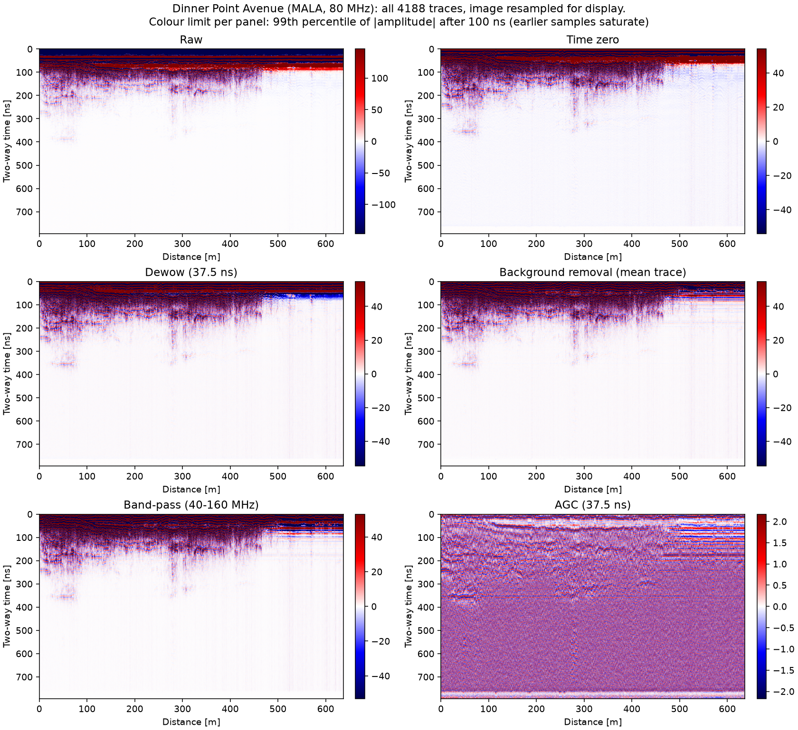

# GPRadar

Simulated and processed ground-penetrating radar (GPR) profiles. gprMax builds the synthetic B-scans. GPRPy is available for field profiles. Short notes on travel time and hyperbolas are in [gpr_basics.md](gpr_basics.md). Signal processing is in [gpr_signal_processing.md](gpr_signal_processing.md). Detection with YOLO is in [gpr_yolo.md](gpr_yolo.md).

Programs and notebooks are numbered in the order to run them. The same number is one stage. A letter means those files do not wait on each other. Where a script and a notebook do the same job, the notebook plots in the page and the script writes a figure file.

## Reproduce

Each step is one `make` target. Every target runs its script in the right conda environment through `conda run`, so nothing needs to be activated first. `make help` lists the targets in this order. The three environments are `gprMax-v4` (simulation, loading, processing, figures, tests), `gprpy` (the GPRPy reference only) and `gprdet` (YOLO); create them from `environment-gprmax.yml`, `environment-gprpy.yml` and `environment-det.yml`. Other names can be passed, e.g. `make test GPRMAX_ENV=myenv`. On Windows, GNU make can come from conda-forge (`conda create -n gpradar-tools -c conda-forge make`) and runs under Git Bash.

Without downloading anything, a reviewer can run the tests and a demo on the small committed sample in `data/sample/` (3 MB):

```bash
make test    # 58 tests; without the full data, 55 pass on data/sample/ and 3 are skipped
make demo    # figures/demo/*.png in about 15 s
```

| Step | Target | Environment | Inputs | Outputs | Approximate time |
| --- | --- | --- | --- | --- | --- |
| Tests | `test` | gprMax-v4 | `data/sample/` (full data used when present) | test report | 6 s |
| Demo | `demo` | gprMax-v4, gprdet if present | `data/sample/`, `best.onnx` if present | `figures/demo/*.png` | 15 s |
| Pipe study and sim figure | `figures-sim` | gprMax-v4 (needs gprMax installed) | `src/pipe.in` | `data/sim/pipe_study/`, `figures/pipe_bscan_variants.png`, `figures/preprocessing_*_sim.png` | about 32 s per pipe B-scan, 8 B-scans |
| Field profile figure | `figure-real` | gprMax-v4 | `data/raw/usgs_forsythe/` | `figures/preprocessing_*_real.png` | seconds |
| GPRPy reference | `gprpy-reference` | gprpy | `data/raw/usgs_forsythe/` | `DinnerPointAve_gprpy_steps.npz` | not timed |
| GPRPy comparison | `gprpy-compare` | gprMax-v4 | the GPRPy `.npz` | `figures/gprpy_comparison.*` | seconds |
| Mendeley inventory | `inventory` | gprMax-v4 | `data/raw/mendeley_gpr/` | `figures/mendeley_inventory/` | not timed |
| Split check | `split` | gprMax-v4 | `data/raw/mendeley_gpr/`, the lock | must equal `data/splits/mendeley_originals.csv` | not timed |
| Field scenes | `scenes` (needs `CONFIRM=1`) | gprMax-v4 (needs gprMax installed) | `configs/scenes.yaml` | `data/sim/scenes/field_400mhz/` | about 10 min per 400 MHz scene on 8 threads: about 33 h for 200 |
| Synthetic images | `synth` | gprMax-v4 | scenes, real train labels | `data/synth/field_400mhz/`, check figures | not timed |
| Real YOLO folders | `real-yolo` | gprdet | `data/raw/mendeley_gpr/`, labels, split | `data/real_yolo/` | seconds |
| Training smoke test | `train-smoke` | gprdet | synthetic and real YOLO sets | `runs/smoke/` | a few minutes (74 s per synthetic epoch, 12 s per real epoch on a Quadro P1000) |
| Full training | `train` (needs `CONFIRM=1`) | gprdet | as above | `runs/detect/`, `results/training_log.csv` | about 19 h without early stopping |
| Evaluation | `evaluate` (needs `CONFIRM=1`) | gprdet | 15 trained weights, locked test set | `results/detection_*.csv`, `figures/detection_*.png` | not timed |
| Ship candidate | `compare` | gprdet | `runs/detect/`, results | printed table | seconds |
| ONNX export | `export-onnx` | gprdet | shipped `best.pt` | `best.onnx`, parity table | under a minute |
| Web demo samples | `demo-samples` | gprMax-v4, then gprdet | raw images, scenes, `best.onnx` | `exports/demo_samples/` | seconds |
| Sample data | `sample-data` | gprMax-v4 | the full data | `data/sample/` | 6 s |

Notes:

- `split` never changes the committed split. It refuses to run without `configs/mendeley_test_lock.txt`, writes the rebuilt split to a temporary file, and fails unless it is identical to the committed one.
- `evaluate` reads the locked test set. The reported results already used it once; run it again only to reproduce them. `python src/06c_evaluate_detectors.py --dry-run` checks the code on the validation set instead.
- No target deletes anything under `data/raw/`.
- gprMax itself is built from source (see `environment-gprmax.yml`); without it, `figures-sim` and `scenes` cannot run, but everything else can.

`data/sample/` (built by `make sample-data`, committed) holds the cylinder A-scan and one pipe B-scan the loader tests use, one 400 MHz val scene as `.npz`, 5 Mendeley train images with boxes and 2 intact train images, and traces 0 to 299 of Dinner Point Avenue. Sources and licences are in `data/sample/CITATION.txt`: the Mendeley images are CC BY 4.0, and the USGS data is public domain (the release lists no use constraints) and is cited as Fiore (2018), https://doi.org/10.5066/F7JH3KBD. No image from the locked test split is included; `test/00_test_sample_data.py` checks that.

## Layout

| Path | Contents |
| --- | --- |
| `Makefile` | One target per pipeline step; `make help` lists them. |
| `src/00_make_sample_data.py` | Builds the small committed sample in `data/sample/` from the full data. |
| `test/00_test_sample_data.py` | Checks the sample: train ids only, unchanged image bytes, labels, citation, size. |
| `data/sample/` | Committed 3 MB sample for tests and the demo, with `CITATION.txt`. |
| `src/pipe.in` | Buried metal pipe. 2D model, 2 mm cells, 1.5 GHz Ricker, 60-trace B-scan. |
| `notebooks/01a_download_usgs_raw.ipynb` | Downloads Dinner Point Avenue and removes the other lines. |
| `src/01a_pipe_bscan_study.py` | Eight variants of `pipe.in`, then one comparison figure. |
| `notebooks/01b_pipe_bscan_study.ipynb` | The same eight runs, plotted in the notebook. |
| `configs/scenes.yaml` | Field-scale presets: 80 MHz and 400 MHz. |
| `src/01c_scene_generator.py` | Draws a 2D scene, writes the `.in` file, the reference trace, and the travel times. |
| `test/01c_test_scene_generator.py` | Checks the draw, the fixed grid, the reference model, and the visibility rule. |
| `test/01b_test_ground_truth.py` | Checks the pipe centre and the soil permittivity. |
| `src/02a_gprmax_loader.py` | Reads a gprMax HDF5 output into one scan. |
| `notebooks/02a_gprmax_loader.ipynb` | The same read, then the Dinner Point Avenue comparison. |
| `test/02a_test_gprmax_loader.py` | Checks the loader against the cylinder and a pipe B-scan. |
| `src/02d_mala_reader.py` | Reads a MALA `.rd3` / `.rad` field profile into the same scan object as 02a. |
| `test/02d_test_mala_reader.py` | Checks the MALA reader on a tiny synthetic file pair and on Dinner Point Avenue. |
| `src/02b_preprocessing.py` | Time zero, dewow, background removal, band-pass and gain. |
| `test/02b_test_preprocessing.py` | Checks those processing steps. |
| `src/02c_gprpy_reference.py` | Runs GPRPy dewow and AGC and saves the reference arrays. |
| `src/03a_plot_preprocessing.py` | Figures of the processing steps and of the amplitude spectrum, for the simulated pipe or (`--profile dinnerpoint`) the field line. |
| `notebooks/03a_scipy_gpr_simulated.ipynb` | Loads one pipe B-scan and shows each processing step. |
| `src/03b_compare_gprpy.py` | Compares dewow and AGC with that GPRPy reference. |
| `test/03b_test_gprpy_comparison.py` | Checks the interior correlation with GPRPy. |
| `src/04a_inventory_mendeley.py` | Read-only inventory of the Mendeley GPR image set. |
| `test/04a_test_inventory.py` | Checks YOLO/VOC conversion, dHash, and that the inventory does not write into the data root. |
| `src/04b_split_mendeley.py` | Locked original split, labelling export, and YOLO label import. |
| `test/04b_test_split.py` | Checks grouping, stratification, the test lock, export bytes, and import validation. |
| `data/splits/mendeley_originals.csv` | Split table for the 285 originals (no image bytes). |
| `configs/mendeley_test_lock.txt` | SHA-256 lock of the sorted test ids. |
| `data/labels/mendeley_originals/` | YOLO labels for the cavity and utility originals (after import). |
| `src/05a_render_synthetic.py` | Renders field_400mhz scenes to 224×224 YOLO greyscale crops. |
| `test/05a_test_render_synthetic.py` | Checks kink fix, crop clipping, YOLO export, scene split, test-id guard. |
| `src/06a_prepare_real_yolo.py` | Real YOLO folders, val split, nested 25/100% subsets, locked test export. |
| `src/06b_train_detectors.py` | YOLO11n train for regimes A/C (and stage-1 for C); smoke and full grid. |
| `src/06c_evaluate_detectors.py` | Locked-test evaluation, summary CSVs, and detection figures. |
| `src/06d_compare_runs.py` | Rank runs by val mAP and pick the locked-test ship candidate. |
| `src/06e_upload_model.py` | Upload the shipped `best.pt`, `best.onnx` and `MODEL_CARD.md` to Hugging Face. |
| `src/06f_export_onnx.py` | Export the shipped model to ONNX; NumPy + OpenCV inference and a parity check. |
| `test/06_test_detection.py` | Group/fraction split guards and IoU matching toy checks. |
| `test/06f_test_onnx_parity.py` | Letterbox and NMS unit tests; ONNX vs Ultralytics parity on 20 train images. |
| `src/07a_export_demo_samples.py` | Pick and export the web demo samples (2 Mendeley train images, 1 val scene), manifest and golden detections. |
| `test/07a_test_demo_samples.py` | Checks test-id refusal, manifest fields and the scene `.npz` round trip. |
| `src/08a_demo.py` | Quick demo on `data/sample/` only: processed scans and (with gprdet) detections in `figures/demo/`. |
| `data/synth/real_train_box_stats.json` | Train-only real box width/height fractions. |
| `data/synth/field_400mhz/` | Synthetic YOLO set (images/labels gitignored; manifest tracked). |
| `environment-gprmax.yml` | Conda environment for gprMax output, processing, and tests. |
| `environment-gprpy.yml` | Conda environment for the GPRPy reference script. |
| `environment-det.yml` | Conda environment for YOLO detection (`gprdet`). |
| `results/` | Detection CSVs and training logs (`detection_results.csv`, `detection_summary.csv`). |
| `data/sim/` | Cylinder A-scan, the pipe-study B-scans, and field-scale scenes. |
| `figures/` | Plots, including detection result and example grids. |

## Environments

gprMax and GPRPy are in separate conda environments. Create them from the repository root:

```bash
conda env create -f environment-gprmax.yml
conda env create -f environment-gprpy.yml
```

`environment-gprmax.yml` installs the Python packages used to read gprMax output and run the processing. gprMax 4.0.1 itself is built from source (https://github.com/gprMax/gprMax) because it needs a C compiler with OpenMP (GCC). Install that release into the `gprMax-v4` environment after creating it.

Run gprMax from this repository. The gprMax checkout contains an uncompiled package, and Python will load that instead of the installed one if it is the current directory.

```bash
conda activate gprMax-v4
python -m gprMax path/to/model.in
```

GPRPy opens a window and asks for a profile (`p`) or a CMP/WARR (`c`):

```bash
conda activate gprpy
gprpy
```

## Cylinder A-scan

The getting-started metal cylinder is already in `data/sim/cylinder_Ascan_2D.h5`. The Ez trace is `figures/cylinder_Ascan_2D_Ez.png`. To run it again, pass `examples/gpr/basic/cylinder_Ascan_2D.in` from the gprMax source tree:

```bash
conda activate gprMax-v4
python -m gprMax /path/to/gprMax/examples/gpr/basic/cylinder_Ascan_2D.in \
  -o data/sim/cylinder_Ascan_2D.h5
MPLBACKEND=Agg python -m gprMax.toolboxes.Plotting.plot_Ascan \
  data/sim/cylinder_Ascan_2D.h5 -save --outputs Ez
```

## Pipe B-scans

`src/pipe.in` is the same kind of model as a B-scan: a metal cylinder in a dielectric half-space, with the antenna pair stepped across it. One 60-trace B-scan of `src/pipe.in` takes about 32 s on a 16-thread laptop CPU (gprMax 4.0.1, OpenMP). The study script keeps that geometry and changes the source and the ground. It runs 8 of the 36 combinations of 3 frequencies (0.9, 1.5, 2.1 GHz), 3 permittivities (4, 6, 12), 2 conductivities (0 and 0.05 S/m), and 2 pipe-centre depths (5 cm and 9 cm). Each run is 60 traces. Finished scans are skipped.

```bash
conda activate gprMax-v4
python src/01a_pipe_bscan_study.py
```

`notebooks/01b_pipe_bscan_study.ipynb` does the same runs and plots the eight B-scans in the notebook instead of writing the PNG. Both write `cases.csv`. From the repository root:

```bash
conda activate gprMax-v4
jupyter notebook notebooks/01b_pipe_bscan_study.ipynb
```

Outputs:

- `figures/pipe_bscan_variants.png`: Ez with the mean trace removed (the script only)
- `data/sim/pipe_study/<tag>/pipe_merged.h5`: one merged B-scan per case
- `data/sim/pipe_study/<tag>/ground_truth.json`: target centre, depth, radius, and permittivity
- `data/sim/pipe_study/cases.csv`: the eight cases

## Field-scale scenes

`src/01c_scene_generator.py` reads `configs/scenes.yaml` and writes one 2D model, in the same form as `pipe.in`, plus a JSON file of the parameters and the predicted hyperbola. It also writes `reference.in`: the same soil and layers, with no targets and no rocks. That model is one trace, saved as `reference.h5`. Subtracting it removes the direct air wave and the horizontal reflections. The soil is a half-space plus 0, 1, or 2 layers, conductivity 0 to 0.01 S/m. Each scene has 1 to 3 targets, a metal pipe, an air-filled PVC pipe, or an air void, and 0 to 5 rocks. A cylinder is drawn large enough to cover at least one cell. Targets sit inside the fixed profile, with 0.05 m of clearance from each other and from the ends.

Every scene in a preset uses the same cell size, time window, domain, and trace count. The cell is checked against one tenth of the shortest wavelength. That wavelength is the slowest soil velocity divided by 2.5 times the centre frequency: the gprMax Ricker has little energy above that multiple. The check allows 0.1 mm, so a round cell size can land the step and the offset on whole cells. At 80 MHz, lambda_min/10 is 0.037474 m and the cell is 0.0375 m. The time window has to cover the bistatic two-way time to the deepest target bottom the preset allows, at that slowest velocity, plus 25%, plus the Ricker delay. The pulse peaks at sqrt(2)/f. The z axis is one cell, as in `pipe.in`, so the PML on that face is 0. The in-plane PML is 10 cells, and the antennas sit two cells above the soil.

The profile length is fixed from that same bound. The flank half-width is the distance at which the hyperbola leaves the window. Full flanks, plus one hyperbola-width of flat ground on each side, is six half-widths. `field_80mhz` needs 15.22 m, so the profile is 15.30 m: 102 steps of 0.15 m, 103 traces. `field_400mhz` needs 10.33 m. The profile is capped at 5.00 m: 100 steps of 0.05 m, 101 traces.

`field_80mhz` is an 80 MHz Ricker. The offset is 0.4875 m, 13 cells, the nearest node to the 0.48 m Dinner Point Avenue pair. The trace step is 0.15 m, 4 cells. Relative permittivity is 4 to 16. Target tops are 0.3 m to 2.0 m. `field_400mhz` is a 400 MHz Ricker. The offset is 0.1625 m, 26 cells, the nearest node to the 0.16 m separation in a shielded housing such as the GSSI 400 MHz antenna. The trace step is 0.05 m, 8 cells. Relative permittivity is 4 to 12. Target tops are 0.2 m to 1.0 m. Those ranges keep one scene to a few minutes.

| Preset | dx | Time window | Domain (x, y) | Profile | Traces | PML |
| --- | --- | --- | --- | --- | --- | --- |
| field_80mhz | 0.0375 m | 102.10 ns | 16.6125 m, 3.975 m | 15.30 m | 103 | 10 cells, 0.375 m |
| field_400mhz | 0.00625 m | 47.10 ns | 5.300 m, 2.2375 m | 5.00 m | 101 | 10 cells, 0.0625 m |

The bound the window is checked against is 102.09 ns at 80 MHz (permittivity 16, target bottom 2.5 m) and 47.07 ns at 400 MHz (permittivity 12, target bottom 1.5 m).

A target is marked visible when its predicted apex is at least one centre period after the direct air wave and still inside the window. The direct wave arrives at the Ricker delay plus the offset divided by the speed of light. A target that fails that test stays in the model as clutter and gets no label. In 1000 draws, the visible share at 80 MHz was 77.3% of air voids (527/682), 81.5% of metal pipes (546/670), and 78.9% of PVC pipes (526/667). At 400 MHz every target was visible (682 air, 670 metal, 667 PVC).

Seed 0, including the reference trace, on this 16-thread CPU:

| Preset | Wall time | Cells | Iterations | Traces |
| --- | --- | --- | --- | --- |
| field_80mhz | 81.6 s | 46958 | 1156 | 103 |
| field_400mhz | 381.9 s | 303584 | 3197 | 101 |

The 80 MHz run is 80.0 s for the B-scan and 1.6 s for the reference. The 400 MHz run is 377.3 s and 4.7 s. Every scene in a preset has this grid, so 300 scenes is about 6.8 hours at 80 MHz and about 31.8 hours at 400 MHz. That batch was not run. A merged file newer than its `.in`, with the full trace count, is skipped.

```bash
conda activate gprMax-v4
python src/01c_scene_generator.py --preset field_80mhz --seed 0 --n 1 --out data/sim/scenes --run --figure figures/scene_field_80mhz_seed0.png
python src/01c_scene_generator.py --preset field_400mhz --seed 0 --n 1 --out data/sim/scenes --run --figure figures/scene_field_400mhz_seed0.png
```

The figure is the raw B-scan beside the processed one, with the predicted hyperbolas drawn on both. Processing is time zero, dewow, background removal, a band-pass around the centre frequency, then AGC. Dewow and AGC use three periods of the centre frequency, the same multiple as the 2 ns window on the 1.5 GHz pipe: 37.5 ns at 80 MHz and 7.5 ns at 400 MHz. The apex check uses the reference-subtracted traces and takes the envelope maximum within half a period of the prediction.

Apex check: 403 of 424 visible targets within a quarter period (0.63 ns); the other 21 are picker failures at the search-window edge or second echoes of air-filled targets, with at most 1.25 ns error.

## Synthetic training images

`src/05a_render_synthetic.py` turns the 200 `field_400mhz` scenes into 224×224 greyscale YOLO crops. Processing is time zero, dewow (7.5 ns), mean-trace removal, band-pass around 400 MHz, then AGC (7.5 ns). The reference trace is not subtracted on the image (real data has none); it is used only to fit boxes on the envelope.

Box rule: for each visible target or clear rock, keep the continuous predicted hyperbola through the apex (drop the outer straight-ray kink), shift it by the same time-zero picks as the image, set the top to the apex minus half a period, and follow the flanks until the reference-subtracted band-passed envelope falls below 20% of its apex value. Then extend the bottom down the apex trace until the envelope stays below that level for one full period (stacked arches), and add half a period. Cap that extension at 3 centre periods below the flank bottom, and stop it where another labelled hyperbola crosses the apex trace. Add two traces on each side. Rocks use the same ``01c`` travel-time function as targets. A rock is labelled if its normal-incidence reflection coefficient against the host soil band is at least 0.03 and its apex arrives at least half a centre period after the direct wave (and inside the window). Targets keep the one-period visibility rule. Class id is 0 for both.

Crops draw width and height fractions from the real train box distribution, resize anisotropically to 224×224, then match the grey histogram of a random train original before JPEG. About 20% of crops are negatives. A crop is redrawn if it contains the apex of any object that is not labelled in that crop (rejected rock, invisible target, or clipped-away box); negatives must contain no apex. Seeds 0-179 are train, 180-199 are val (by scene, not by crop). Test-split Mendeley ids are never read. The left white strip on early check panels was a plot-extent mismatch (midpoint boxes on a receiver-x axis), not blank data; crops use midpoints and skip near-empty columns.

Render on 200 scenes (6 crops each): 1166 crops written (34 gave up after redraws; train 1051 = 871 pos / 180 neg; val 115 = 95 pos / 20 neg). YOLO boxes 2948 (train 2688 = 1449 target / 1239 rock; val 260 = 136 target / 124 rock). Physical boxes: 424 targets and 385 rocks labelled; 115 rocks rejected. Cap applied on 287/809 boxes (share 0.355). Crop draws rejected for an unlabelled apex: 3950. Crop YOLO medians: width 0.475 / height 0.499 (real train 0.471 / 0.502).

```bash
conda activate gprMax-v4
python src/05a_render_synthetic.py
```

Outputs: `data/synth/field_400mhz/{images,labels}/{train,val}/`, `dataset.yaml`, `manifest.csv`, `data/synth/real_train_box_stats.json`, `figures/synthetic_boxes_check.png`, `figures/synthetic_rocks_check.png`, and `figures/synthetic_vs_real.png`.

## Reading a gprMax file

`load_gprmax` accepts a `.h5` or `.out` file, a directory of per-trace files, or a list of those paths. The result is one object: a time-by-trace array, `dt` in seconds, trace spacing in metres, centre frequency in hertz, and the source description.

```bash
conda activate gprMax-v4
python -c "
import importlib
import sys
sys.path.insert(0, 'src')
loader = importlib.import_module('02a_gprmax_loader')
scan = loader.load_gprmax('data/sim/cylinder_Ascan_2D.h5')
print(scan.data.shape, scan.dt, scan.frequency, scan.source.kind)
"
```

A single A-scan has no trace spacing. A merged B-scan does not keep the waveform, so `frequency` is `None` unless you load the per-trace files from before they were merged.

`notebooks/02a_gprmax_loader.ipynb` reads the same files, then compares a running-mean dewow and a running-RMS AGC with the GPRPy windows on Dinner Point Avenue. The six panels are plotted in the notebook.

```bash
conda activate gprMax-v4
jupyter notebook notebooks/02a_gprmax_loader.ipynb
python -m pytest test/02a_test_gprmax_loader.py
```

## Preprocessing

The steps in `src/02b_preprocessing.py` run in this order:

1. **Time zero**: shift each trace so the first break is at the start of the record.
2. **Dewow**: subtract a running mean and remove the low-frequency bias from antenna coupling.
3. **Background removal**: subtract the mean trace and remove the horizontal direct wave.
4. **Band-pass**: keep about half to twice the antenna frequency, without shifting the pulse.
5. **Gain**: divide by a running RMS so a weaker late reflection remains visible.

```bash
conda activate gprMax-v4
python -m pytest test/02b_test_preprocessing.py
MPLBACKEND=Agg python src/03a_plot_preprocessing.py
```

`notebooks/03a_scipy_gpr_simulated.ipynb` loads the 1.5 GHz pipe scan and shows each step with its image. From the repository root:

```bash
conda activate gprMax-v4
jupyter notebook notebooks/03a_scipy_gpr_simulated.ipynb
```

On this 12 cm profile the hyperbola covers most traces, so mean-trace removal leaves artefacts near the apex. Longer profiles, or subtracting a no-target simulation, avoid this.

### The same steps on the field profile

The same functions run on Dinner Point Avenue (MALA, 80 MHz antenna, 4188 traces, 0.152 m apart, 0.78125 ns per sample). The windows follow the same rule as for the pipe, three periods of the centre frequency: dewow 37.5 ns, band-pass 40 to 160 MHz, AGC 37.5 ns. Time zero is again the first sample at 5% of each trace's peak.

```bash
conda activate gprMax-v4
MPLBACKEND=Agg python src/03a_plot_preprocessing.py --profile dinnerpoint
```



All 4188 traces are plotted; matplotlib resamples the image to fit each panel. The direct wave is so much stronger than the reflections that a colour limit over the whole panel hides everything else, so each panel's limit is the 99th percentile of |amplitude| after 100 ns, and the direct wave saturates.

- **Raw**: the direct wave arrives at about 30 to 60 ns. A slow tail follows it, seen as the red band under the direct wave beyond 470 m.
- **Time zero**: moves the first break (about 31 ns) to the top of each trace. The bottom 30 ns or so is then zero.
- **Dewow**: removes the slow tail without moving the reflections.
- **Background removal**: removes the flat bands that are the same on every trace. The ringing from 470 m to the end is stronger than the profile average, so it is only partly removed and stays as horizontal stripes.
- **Band-pass**: keeps 40 to 160 MHz. In `figures/preprocessing_spectrum_real.png` the spectrum peaks near 95 MHz, and the filter removes a shoulder at 170 to 250 MHz.
- **AGC**: evens out the amplitude down the trace. Dipping reflectors show to about 350 ns over the first 470 m; below that AGC mostly amplifies noise. The bright band at the bottom is the zero-filled tail from the time-zero shift.

## Real data: Mendeley GPR dataset

Detection tests use Mojahid et al. (2025), *Intelligent recognition of subsurface utilities and voids using ground-penetrating radar and deep learning techniques: Data of GPR profiles images*, Data in Brief / Mendeley Data, DOI [10.17632/ww7fd9t325.1](https://doi.org/10.17632/ww7fd9t325.1). Unzip the download into `data/raw/mendeley_gpr/` (gitignored). Do not commit those images.

```bash
conda activate gprMax-v4
python src/04a_inventory_mendeley.py --root data/raw/mendeley_gpr --out figures/mendeley_inventory
```

That walk is read-only on the data root. It writes `figures/mendeley_inventory/files.csv`, `boxes.csv`, `groups.csv`, `summary.md`, plus `figures/mendeley_inventory_originals.png` and `figures/mendeley_inventory_matches.png`.

| Class | Originals | Augmented | Published class total |
| --- | ---: | ---: | ---: |
| void (`cavities`) | 79 | 553 | 553 |
| utility (`Utilities`) | 131 | 786 | 786 |
| intact | 75 | 900 | 900 |

The published 2,239 count matches the three augmented folders. The 285 originals are present as well. Antenna frequency is not recorded in the files (`frequency = unknown`). YOLO class id 0 is used for both void and utility; intact images have no boxes. Only augmented void and utility images carry YOLO and VOC labels.

The augmented folders are not used for training or evaluation. Only 328 of 2,239 augmented images matched an original at high confidence, so the mapping is not reliable enough for a leakage-free split. The working set is the 285 originals, with one detection class `target`. Intact originals are negatives (no boxes). The 210 cavity and utility originals are labelled by hand.

Near-duplicates among originals (identity dHash ≤ 6, or a flip/rotation with transform dHash ≤ 2) are grouped and always share a split. The split is stratified by folder class at the group level: 30% test, 70% train, seed 0. Counts: void 55/24 train/test images (55/24 groups), utility 92/39 (90/38 groups), intact 55/20 (45/19 groups). 271 groups in total. The sorted test ids are locked in `configs/mendeley_test_lock.txt`.

```bash
conda activate gprMax-v4
python src/04b_split_mendeley.py split
python src/04b_split_mendeley.py export
```

`export` copies the 210 cavity and utility originals to `data/raw/mendeley_labelling/images/` under stable ids (`void_0014.jpg`, `utility_0181.jpg`, …) without encoding the split. `labels.txt` holds the single class name `target`. `figures/mendeley_labelling_guide.png` shows the authors' boxes on augmented images as a visual reference.

Labelling rule: one box per target hyperbola or void anomaly. The box spans the apex and the visible flanks down to where they fade into the background. Overlapping hyperbolas from one target get one box.

In makesense.ai: upload `data/raw/mendeley_labelling/images/`, load `labels.txt`, draw the boxes, export "YOLO" as a zip, and unzip it to `data/raw/mendeley_labelling/labels_yolo/`. Then:

```bash
python src/04b_split_mendeley.py import
```

Import checks that every exported image has a class-0 box inside the frame (at least 4 px wide and tall), then writes `data/labels/mendeley_originals/<id>.txt`.

Limitation: The antenna frequency of each real image is not recorded in the dataset (200 or 400 MHz). Synthetic scans were simulated at 400 MHz and matched to the real images by image scale, not by time or depth.

## Field profile

Dinner Point Avenue is the only line this repository keeps from the USGS Forsythe release. `notebooks/01a_download_usgs_raw.ipynb` checks the two published files, `DinnerPointAve.rd3` and `DinnerPointAve.rad`, and deletes the other profiles if they are in `data/raw/usgs_forsythe/`.

```bash
conda activate gprMax-v4
jupyter notebook notebooks/01a_download_usgs_raw.ipynb
```

### Reading the field profile

`src/02d_mala_reader.py` reads the profile: `load_mala("data/raw/usgs_forsythe/DinnerPointAve.rd3")` returns the same scan object as the gprMax loader (`data` as samples x traces, `dt`, `trace_spacing`, `frequency`). The `.rd3` file is int16 samples, one trace after another; the `.rad` file is the text header. Two header fields are easy to confuse: `FREQUENCY` (1280 MHz) is the sampling rate, so dt is 0.78125 ns, while the antenna frequency (80 MHz) is in `ANTENNAS`. The reader stops if the file size is not a whole number of traces, and warns and uses 1 m if `DISTANCE INTERVAL` is 0. For this line: 1017 samples x 4188 traces, 0.152 m between traces. `notebooks/02a_gprmax_loader.ipynb` uses the same reader.

## Cross-check against GPRPy

Dewow and AGC were compared with GPRPy 1.0.14 on that profile (MALA, 4188 traces). GPRPy's result is `data/raw/usgs_forsythe/DinnerPointAve_gprpy_steps.npz`. That file is about 100 MB and is gitignored. Recreate it, then run the comparison:

```bash
conda activate gprpy
python src/02c_gprpy_reference.py
```

```bash
conda activate gprMax-v4
MPLBACKEND=Agg python src/03b_compare_gprpy.py
```

`src/03b_compare_gprpy.py` does not import GPRPy. It reads the `.npz`, runs `dewow` (25 ns) and then `gain_agc` (50 ns), and writes `figures/gprpy_comparison.csv` and `figures/gprpy_comparison.png`. "Interior" drops one window from each end of the trace: 32 samples for dewow, 64 for AGC.

| Step | Region | Max abs. difference | Relative RMS | Correlation |
| --- | --- | --- | --- | --- |
| dewow | full | 1080.6326 | 0.030876 | 0.999541 |
| dewow | interior | 1080.6326 | 0.025966 | 0.999686 |
| AGC | full | 3.7854 | 6.782221 | 0.976026 |
| AGC | interior | 3.6120 | 7.051782 | 0.999535 |

GPRPy's moving window is one sample longer (33 and 65 instead of 32 and 64) and is centred differently, and its edge samples share one frozen window. Dewow still matches: interior correlation 0.999686, relative RMS 0.026. AGC does not match in amplitude. GPRPy divides by the L2 norm of the window; `gain_agc` divides by the RMS, about `sqrt(64)` smaller. The relative RMS of about 7 is that factor. Interior correlation stays 0.999535 because correlation ignores a constant scale. On the full trace the AGC correlation falls to 0.976026 because of the frozen edge gain. The two AGC panels in the figure share a colour scale, so the GPRPy panel looks pale and the difference looks like the `02b_preprocessing.py` panel.

## Detection experiment

Research question: with 25% and 100% of the real train labels, does a detector pre-trained on synthetic B-scans and fine-tuned on real ones (regime C) detect hyperbolas better on the real test set than one trained on real data only (regime A)?

Design: YOLO11n, image size 224, batch 16. Regime A starts from the COCO checkpoint. Regime C first trains on `data/synth/field_400mhz` (60 epochs, patience 20), then fine-tunes on real data like A (150 epochs, patience 40). Real train groups are split into validation (20% of groups, seed 0) and a train pool; nested 25% and 100% pool subsets are drawn for seeds 0, 1 and 2. Full grid: {A, C} x {25%, 100%} x seeds {0, 1, 2} plus three stage-1 runs (15 weights). Regime B is stage-1 only (synthetic, no real fine-tune), evaluated on the real test set for reference. The locked test split (83 images) is used only by `06c` after all training.

Environment (`gprdet`, Python 3.11). Ultralytics is AGPL-3.0. PyTorch is installed from the CUDA 12.4 wheel index so Pascal GPUs (compute capability 6.1) still work; newer CUDA 12.8+ builds dropped Pascal.

```bash
conda env create -f environment-det.yml
conda activate gprdet
python -c "import torch; print(torch.__version__, torch.cuda.is_available()); x=torch.randn(2,3,device='cuda'); print(float(x.sum()))"
```

Prepare real YOLO folders (train/val subsets and a separate test folder; greyscale PNG as 3-channel):

```bash
conda activate gprdet
python src/06a_prepare_real_yolo.py
```

Smoke test (2 epochs, seed 0, 25% only: one stage-1, one A, one C):

```bash
conda activate gprdet
python src/06b_train_detectors.py --smoke
```

Full training (skips finished `best.pt`; log in `results/train_all.log`):

```powershell
conda activate gprdet; python src/06b_train_detectors.py --seeds 0 1 2 --fractions 0.25 1.0 --regimes A C *>&1 | Tee-Object -FilePath results/train_all.log
```

Evaluation on the locked test set (run once after training; refuse if any of the 15 weights is missing):

```powershell
conda activate gprdet; python src/06c_evaluate_detectors.py
```

Dry-run check (validation images + smoke weights only):

```bash
conda activate gprdet
python src/06c_evaluate_detectors.py --dry-run
```

Compare runs and confirm the ship candidate (A_f100 vs C_f100):

```bash
conda activate gprdet
python src/06d_compare_runs.py
```

Export the shipped model to ONNX for a CPU-only service (opset 12, fixed 224 x 224 input, output 1 x 5 x 1029, no NMS in the graph). The script writes `best.onnx` next to `best.pt` and prints the input and output shapes. It also includes a small inference path that uses only NumPy, OpenCV and onnxruntime: letterbox, NMS and `detect`. `--check 20` compares that path with Ultralytics on 20 train-split images (never test images). With the same square input (`rect=False`), boxes and scores are identical. Note: Ultralytics `predict` and `val` on `best.pt` default to `rect=True` and pad only to a multiple of 32. The ONNX model always sees the full square, so scores can differ by up to about 0.01, and a box near the 0.25 threshold can appear or disappear (1 of 20 images). The locked-test numbers were measured with `rect=True`.

```bash
conda activate gprdet
python src/06f_export_onnx.py --check 20
```

Upload the shipped weights, the ONNX file and `MODEL_CARD.md` as the Hub README (`A_f100_seed2` by default):

```bash
conda activate gprdet
python src/06e_upload_model.py
```

Figures: `figures/detection_results.png`, `figures/detection_examples.png`. Locked-test numbers are below.

## Results (locked test set: 83 real images, 3 seeds per setting)

| Regime | Real labels | mAP@0.5 (mean ± std) | Recall utility | Recall void | FP per image | FP per intact image |
| --- | --- | --- | --- | --- | --- | --- |
| B: synthetic only | 0 | 0.161 ± 0.051 | 0.36 | 0.12 | 0.59 | 0.15 |
| A: real only | 25% (38 images) | 0.687 ± 0.047 | 0.87 | 0.53 | 1.73 | 0.17 |
| C: synthetic + real | 25% (38 images) | 0.661 ± 0.064 | 0.86 | 0.47 | 0.90 | 0.02 |
| A: real only | 100% (156 images) | 0.756 ± 0.042 | 0.90 | 0.51 | 0.55 | 0.00 |
| C: synthetic + real | 100% (156 images) | 0.732 ± 0.024 | 0.84 | 0.56 | 0.63 | 0.00 |

Recall and false positives at confidence 0.25 and IoU 0.5.

C minus A in mAP@0.5 (paired bootstrap over test images, 2000 resamples): 25%: -0.026 (95% CI -0.090 to +0.056); 100%: -0.024 (95% CI -0.055 to +0.042).

**Finding:** synthetic pre-training did not measurably improve detection at either amount of real labels; both intervals include zero. More real labels helped more (+0.07 mAP for A from 25% to 100%).

**Ship candidate:** among A_f100 and C_f100 on the locked test set, `A_f100_seed2` is best (mAP@0.5 = 0.786, mAP@0.5:0.95 = 0.438). Best validation mAP50-95 among those six runs was A_f100_seed0; the locked test prefers seed 2, which is what `06e` uploads.

**Why:** the synthetic-only model reaches 0.16 mAP on real images, so little of what it learns transfers. The gap is much smaller for utilities (recall 0.36 without any real data) than for voids (0.12): synthetic targets are single hyperbolas, while real voids are clusters of arches. Voids are the hard class in every regime (recall about 0.5). At 25% labels, C produced fewer false positives (0.90 vs 1.73 per image), but one A seed dominates that difference and it was not tested, so it is an observation, not a result.

**Note:** seed 0 alone suggested a gain on the validation set (+0.11 mAP@0.5 at 25%); it did not hold on the test set or across seeds.

**Limitations:** one model size (YOLO11n) at 224 px; 83 test images; all fine-tunes ran the full 150 epochs; 2D simulation at 400 MHz while the real frequency (200 or 400 MHz) is unknown; synthetic scenes more crowded than real images (median 3 boxes per crop vs 1 to 2); synthetic voids are single cylinders.

**Future work (exploratory, judged on validation only, since the test set has been used):** simulate void clusters, add a 200 MHz preset, train longer.

## Web demo samples

`src/07a_export_demo_samples.py` picks three small samples for the GPRadar-API web service and writes them to `exports/demo_samples/` (gitignored), with `manifest.json` (id, name, kind, file, default mode, citation, description). The Mendeley images come from the train split only; the script checks the test lock and refuses test ids.

- Mendeley: the utility and the void train image with 1 to 2 boxes whose largest box covers the most of the image (now `utility_0028` and `void_0045`), copied byte for byte with their YOLO labels. Override with `--utility-id` and `--void-id`.
- gprMax: a val scene (seeds 180 to 199) with 1 to 2 visible targets, no flagged apex check, and every apex at least 1 m from the profile ends; then the fewest labelled rock boxes and the lowest seed (now seed 182, an air void). Saved as a compressed `.npz` (about 1 MB): `data` (float32), `dt`, `trace_spacing`, `frequency`, `scene_json`, and `processed_u8_224`, the full record after the 05a processing, scaled to 8-bit and resized to 224 x 224. Override with `--seed`.
- `golden.json`: the ONNX detections (confidence 0.25 or more, IoU 0.5) on each sample, for the API's golden test. The scene is run on `processed_u8_224`.

Export runs in `gprMax-v4` (it reads HDF5 and uses SciPy); the golden file needs onnxruntime, so it runs in `gprdet`:

```bash
conda activate gprMax-v4
python src/07a_export_demo_samples.py export
conda activate gprdet
python src/07a_export_demo_samples.py golden
```

Licence: the Mendeley images are CC BY 4.0, so they may be redistributed with credit: Mojahid et al. (2025), Mendeley Data, DOI 10.17632/ww7fd9t325.1. The manifest carries this citation for each image. The scene is our own simulation, credited as "Simulated with gprMax (Warren et al. 2016)".
